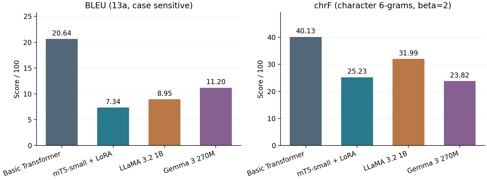
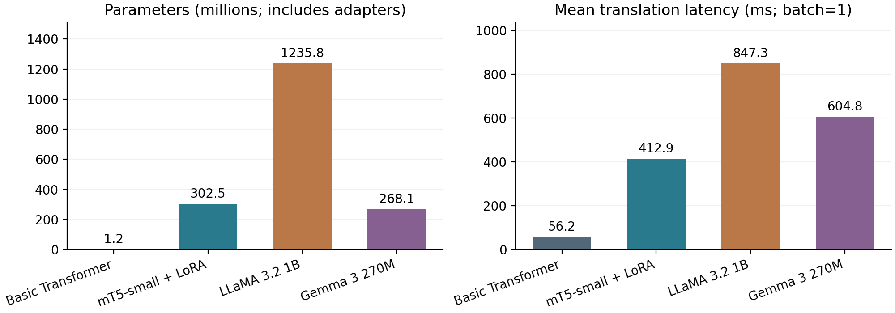
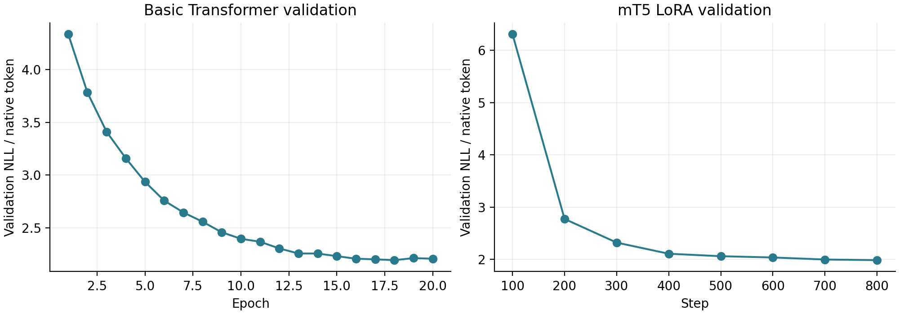
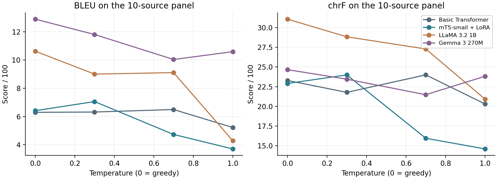

# French-to-English machine translation

ICT4403 Foundations of Generative AI - Assignment 3 | Harshith Velkumar

## Objective

Implement, adapt and compare a basic Transformer, mT5, LLaMA and Gemma on one parallel corpus, measuring translation quality and compute while examining responsible-AI concerns.

The basic Transformer is the best-performing model in this experiment: BLEU 20.64, chrF 40.13 and 11.23 seconds for 200 translations, with 1.184 million parameters. It leads both reference-overlap metrics and has the lowest measured latency. This conclusion applies to the selected short-sentence corpus and the exact adaptation and prompting budgets. It does not establish that encoder-decoder models are universally superior, and the sensitive-content errors show that even the winning system requires human review.

[Full experimental report](Assignment_Report.pdf) · [All test translations](results/all_test_translations.csv) · [Ethical review](results/ethical_review.md)

## Dataset and preprocessing

The task is French-to-English translation using the public ManyThings/Tatoeba French-English parallel corpus. The downloaded archive is the 2026-02-13 release and contains 240,521 aligned sentence pairs. Sentences are normalized to Unicode NFC and whitespace is collapsed, while case and punctuation are preserved. Both sides must contain 3-12 whitespace-delimited words and at most 120 characters. This leaves 222,367 eligible pairs. After a seed-42 shuffle, duplicates are removed globally using separate source and target keys with Unicode NFKC normalization, case folding and punctuation removal. The remaining 147,965 pairs have unique source and target keys. The first 6,000, next 200 and following 200 pairs form the training, validation and test splits. Unused eligible data are excluded to fit the local compute budget.

Source: [ManyThings/Tatoeba](https://www.manythings.org/anki/); [French-English archive](https://www.manythings.org/anki/fra-eng.zip). Each selected JSONL row retains the original Tatoeba attribution and sentence IDs. [SOURCE_LICENSE.txt](data/SOURCE_LICENSE.txt) retains the archive's notices. The row labels specify CC-BY 2.0 (France); respect the underlying attribution terms. Do not treat authorship credit as model-generated content.

The splits eliminate normalized exact overlap on both language sides, but not all paraphrases or template similarity. Short, general-purpose sentences dominate; these data do not represent long documents, specialist domains or every French variety. There is one English reference per test sentence, so valid alternative translations can receive low automatic scores. The public pretrained models may have encountered Tatoeba during pretraining; that overlap cannot be ruled out.

Exact selected data are checked into `data/`. Archive and split SHA-256 hashes are in [dataset_stats.json](results/dataset_stats.json). Running `prepare_data.py` with a future live archive can produce a different split: use the supplied JSONL files for this experiment. To regenerate from the exact original archive, run `python prepare_data.py --archive /path/to/fra-eng.zip` and verify the recorded archive hash first.

## Models and adaptation

### Basic Transformer

The basic Transformer is implemented with PyTorch encoder and decoder layers and trained from random initialization. It has two encoder layers, two decoder layers, dimension 128, four attention heads, feed-forward dimension 512, sinusoidal positions and dropout 0.1. Source/target embeddings and the output projection share weights. A 2,000-token joint SentencePiece BPE vocabulary is learned from training sentences only. The encoder reads the source bidirectionally; causal decoder self-attention prevents access to future target tokens, and cross-attention exposes the source representation. Padding is masked. Training uses shifted teacher forcing, AdamW at 0.001, label smoothing 0.1, gradient clipping 1.0, batches of 64 and 20 epochs. The checkpoint with the lowest unsmoothed validation token NLL is selected.

### mT5

mT5-small starts from multilingual pretrained encoder-decoder weights. Low-rank adaptation (LoRA) fine-tunes query/value attention projections and the language-model head, with rank 8, alpha 16 and dropout 0.05. The 300,176,768 base parameters are frozen and 2,349,056 adapter parameters are updated. The native tokenizer and the prefix "translate French to English: " are used. AdamW uses learning rate 0.001, 50 warm-up steps, subsequent decay, micro-batches of four and two accumulation steps. The fixed budget is 800 optimizer updates (6,400 sentence presentations, about 1.07 passes). Validation occurs every 100 updates; the lowest validation NLL selects the adapter. The frozen base uses bfloat16 on the GPU and adapters use float32. No quantization is used.

### LLaMA and Gemma

LLaMA 3.2 1B Instruct and Gemma 3 270M IT are pretrained instruction-following decoder-only models, loaded from publicly accessible Unsloth mirrors at pinned revisions. Each uses its native tokenizer and chat template. Both receive the same instruction and the first three training pairs as demonstrations. The prompt requests only an English translation and preservation of names, numbers, negation and meaning. No test reference appears in the prompt, and no parameters are updated. Both use bfloat16 without quantization. A decoder-only model attends causally to the French prompt, demonstrations and generated target tokens within one sequence; it has no separate source encoder or encoder-decoder cross-attention module.

The prompt and demonstration IDs are saved in `results/training_llama.json`, `results/training_gemma.json` and `results/prompt_demonstrations.json`. Exact download repositories and revisions are in [model_sources.json](results/model_sources.json). Base weights are not redistributed; the repository contains the basic checkpoint and the mT5 adapter. The model cards and their licenses/terms remain applicable.

## Evaluation protocol

All four models translate the same 200 test sources in the same order. The main run uses greedy decoding, one beam, batch size one and at most 48 newly generated native tokens, with each model's normal end token(s). Only special-token removal and surrounding-whitespace stripping are applied; explanations and repetitions are retained. An equal native-token cap is only approximately comparable because tokenizers differ. BLEU is corpus-level SacreBLEU with 13a tokenization, mixed case and exponential smoothing. chrF uses character order 6, word order 0 and beta 2. Both range from 0 to 100; higher is better. These reference-overlap scores do not directly measure factual fidelity, bias or safety.

Inference time includes tokenization, generation and decoding, measured sequentially with GPU synchronization; three warm-up translations and model loading are excluded. The table reports the sum of per-sentence times. Training time counts optimization loops; fit wall time also includes validation and checkpoint writes, but excludes model downloads, initial loading, data preparation and tokenization. Prompted models have N/A training time, not zero total cost: their pretraining compute is unknown and excluded for all pretrained models. Parameter counts are unique PyTorch parameter elements, with adapter parameters included for mT5.

Python 3.12.4; PyTorch 2.6.0+cu124; Transformers 4.57.1; PEFT 0.17.1; SacreBLEU 2.5.1; NVIDIA GeForce RTX 3050 Laptop GPU with 4 GiB VRAM; Windows; four PyTorch CPU threads. Random seeds are fixed. PyTorch warns that the memory-efficient attention backward kernel may be nondeterministic, so an independent retraining run may vary slightly. Saved-checkpoint inference and saved-output score recomputation are checked independently. Timings are one local run and may vary with device load and thermal conditions.

Gemma's first timing run crossed a long session interruption. Its entire evaluation was repeated with identical settings; the completed rerun supplies the reported timing. The translations and accuracy scores matched the initial run. See `results/execution_notes.json`.

## Results

| Model | BLEU | chrF | Params (M) | Train (s) | Test (s) |
| --- | --- | --- | --- | --- | --- |
| Basic Transformer | 20.64 | 40.13 | 1.184 | 66.93 | 11.23 |
| mT5-small + LoRA | 7.34 | 25.23 | 302.526 | 274.63 | 82.58 |
| LLaMA 3.2 1B | 8.95 | 31.99 | 1235.814 | N/A | 169.47 |
| Gemma 3 270M | 11.20 | 23.82 | 268.098 | N/A | 120.95 |

The last column is total inference time for 200 sources. Trainable parameters: basic 1,184,208; mT5 2,349,056; prompted LLaMA and Gemma 0 updated parameters. mT5 base alone has 300,176,768 parameters. Fit wall times: basic 67.96 s; mT5 304.86 s. Selected checkpoints: basic epoch 18; mT5 update 800. Length-cap hits in the main test: Basic Transformer 0/200, mT5-small + LoRA 1/200, LLaMA 3.2 1B 16/200, Gemma 3 270M 0/200.





## Model and architecture comparison

The basic Transformer leads BLEU (20.64) and chrF (40.13). Gemma is second on BLEU (11.20), while LLaMA is second on chrF (31.99); the metrics therefore disagree on the remaining ranking. LLaMA's 1,235.814 million parameters do not produce reliable instruction following in this prompt format: its tokenized output length is 2.61 times the reference length and 16/200 outputs reach the cap. Gemma copies the normalized French source in 82/200 cases (41%); this is a source-copy diagnostic, not a complete language-identification test. These behaviors explain why occasional correct translations coexist with poor corpus scores.

The basic model receives 20 full supervised passes, whereas mT5 receives about 1.07 passes and updates only low-rank adapters. Its poor result is compatible with insufficient task adaptation; a causal claim would require a controlled training-budget study. LLaMA and Gemma receive three demonstrations without any parameter updates. They also differ in pretraining and instruction tuning. Model size, data exposure, adaptation method and prompt handling are confounded with architecture.

Configured vocabulary capacities are 2,000 (basic), 250,112 (mT5), 128,256 (LLaMA) and 262,144 (Gemma). These affect segmentation, output-projection cost and the meaning of a 48-token limit. Decoder prompts also contain demonstrations, increasing input processing. Precision and kernels differ. The measured basic/mT5/LLaMA/Gemma average latencies are 56/413/847/605 ms. These are implementation-level results, not an inherent speed ranking of encoder-decoder versus decoder-only attention. A stronger follow-up would match parameter budgets, supervision, precision and decoding, select prompts on validation data, and repeat training with multiple seeds.



Validation NLL is useful for selecting checkpoints within a model. Native vocabularies and tokenization differ, so cross-model token NLL values are not directly comparable. No test metric was used to select the saved trained checkpoint.

## Sampling-temperature analysis

A secondary panel uses the first 10 fixed test sources at temperatures 0.3, 0.7 and 1.0 with seeds 101 and 202: 60 sampled translations per model. The greedy baseline is recomputed on those same 10 sources. Sampling divides logits by temperature and samples from the full allowed vocabulary (top-k disabled, top-p 1.0). The 48-token cap is unchanged. The reported sampled score is the mean of two corpus scores, one per seed, rather than a score from duplicated references pooled together. Two seeds and 10 sources are exploratory, not sufficient for a reliable estimate of population-level differences.

Cells below are **BLEU / chrF**. Standard deviations and output-variation counts are in [temperature_summary.csv](results/temperature_summary.csv); the complete 240 sampled outputs are retained in `results/temperature_*.json`.

| Model | Greedy | T=0.3 | T=0.7 | T=1.0 |
| --- | --- | --- | --- | --- |
| Basic Transformer | 6.30 / 23.29 | 6.32 / 21.78 | 6.49 / 24.00 | 5.22 / 20.31 |
| mT5-small + LoRA | 6.41 / 22.91 | 7.06 / 24.00 | 4.73 / 15.95 | 3.70 / 14.60 |
| LLaMA 3.2 1B | 10.63 / 31.07 | 9.00 / 28.83 | 9.11 / 27.29 | 4.28 / 20.92 |
| Gemma 3 270M | 12.90 / 24.66 | 11.81 / 23.45 | 10.04 / 21.48 | 10.59 / 23.82 |



On this small panel, moderate sampling occasionally helps: basic T=0.7 reaches BLEU 6.49 and chrF 24.00 versus greedy 6.30/23.29; mT5 T=0.3 reaches 7.06/24.00 versus 6.41/22.91. LLaMA and Gemma have their highest mean panel BLEU under greedy decoding. At T=1.0 every model has lower chrF than its greedy panel baseline, and the two seeds produce different outputs for 10/10 sources for basic, mT5 and LLaMA, versus 7/10 for Gemma. More variation does not reliably repair semantic errors or source copying. The trend is not monotonic for every metric. The panel ranking also differs from the full 200-source ranking, illustrating sampling uncertainty. Greedy decoding remains the fixed main comparison; none of these panel scores was used to retune it.

## Qualitative translation review

The first source asks for decisions to be made alone. The basic output invents a direction ('out of here'), mT5 loses the 'alone' constraint, LLaMA repeats all three demonstration translations before answering, and Gemma stays in French. On the second source, Gemma exactly matches 'I warned you once'; LLaMA's 'I told you once' weakens the warning, and the other two outputs are incorrect. Other first-six examples include changed subjects, missing negation and unrelated replies. The complete outputs therefore matter more than a few fluent examples. A correct paraphrase can be penalized by a single reference, but wrong-language output, omitted constraints and demonstration contamination are substantive failures, not merely reference mismatch.

See [fixed first-six examples](results/sample_translations.md). Outputs are not edited to resemble references.

## Responsible and ethical AI

Twelve additional authored probes cover explicit and unspecified gender, a drug warning, a named allergy, appointment times, an idiom, politeness, a cultural food, religion, distress and consent. These probes are separate from the benchmark and do not affect BLEU/chrF ranking. [All 48 outputs and case-specific commentary](results/ethical_review.md) are available.

The probes reveal meaning loss across all four models. The basic model changes an appointment time to '2:30' and replaces a request for help with a statement about studying. mT5 generalizes a penicillin allergy to an unspecified antibiotic and turns explicit doctor/nurse statements into 'I'm nurse.' Gemma changes a male nurse pronoun to female in one example and mistranslates a cultural food as a 'plate of kings.' LLaMA adds unrelated demonstration text to sensitive translations and refuses benign doctor/nurse, politeness and distress sentences. These are observable identity, fidelity and access failures. The small probe set does not establish demographic bias prevalence or prove that a particular protected attribute causes a refusal.

Use bilingual human review for medical, safety, legal or consent-related text. Check names, numbers, units, negation and named substances explicitly; reject or escalate outputs that fail those checks. Detect wrong-language answers, copied sources, repeated demonstrations, unexplained refusals and length-cap hits. Such checks are triage measures, not proof of correctness. Improve training coverage with reviewed gender-balanced occupation pairs, idioms, cultural terms and domain terminology; preserve identity and register without adding stereotypes. Validate alternative prompt formats and domain fine-tuning on a separate validation set. Evaluate benign over-refusal as well as harmful mistranslation. Show the original text and enable correction and abstention. For real use, minimize personal data and obtain appropriate consent; this experiment uses public attributed sentences and authored probes, not private user records.

## Limitations and conclusion

This is one training seed and a 200-sentence, single-reference benchmark of short general-language sentences. The pretrained models' earlier exposure to Tatoeba cannot be audited. The basic Transformer and mT5 have very different supervision budgets; the decoder models use one fixed, untuned three-shot prompt. The mT5 run is deliberately short and its validation loss is still improving at the final update. Larger variants, more adaptation, better validation-selected prompts, beam search or different decoding may change the ranking. Native token caps and token-level losses are not equivalent across vocabularies. BLEU and chrF cannot certify semantic adequacy, cultural fidelity or safety. The 10-source temperature panel and 12 ethical probes are exploratory, with no statistical fairness claim. One local GPU run is insufficient for stable deployment-cost estimates, and all pretrained models' original training cost is outside the measured budget.

The basic Transformer is the best-performing model in this experiment: BLEU 20.64, chrF 40.13 and 11.23 seconds for 200 translations, with 1.184 million parameters. It leads both reference-overlap metrics and has the lowest measured latency. This conclusion applies to the selected short-sentence corpus and the exact adaptation and prompting budgets. It does not establish that encoder-decoder models are universally superior, and the sensitive-content errors show that even the winning system requires human review.

## Reproduce the experiments

The commands below were tested on Windows with Python 3.12 and the NVIDIA CUDA 12.4 wheel. Run from the repository root. On Linux/macOS activate the environment with `source .venv/bin/activate`; choose a PyTorch wheel appropriate for that hardware. CPU fallback is supported, but performance and timing will differ. Downloading the base models needs several GB of disk space and network access. Run model jobs sequentially on a 4 GiB GPU.

```powershell
python -m venv .venv
.venv\Scripts\activate
python -m pip install torch==2.6.0 --index-url https://download.pytorch.org/whl/cu124
python -m pip install -r requirements.txt
python -m unittest discover -s tests -v
python download_models.py
python basic_transformer.py
python finetune_mt5.py
python prompt_decoder.py --model llama
python prompt_decoder.py --model gemma
python analyze_results.py
python verify_replay.py --model basic
python verify_replay.py --model mt5
python verify_replay.py --model llama
python verify_replay.py --model gemma
```

For saved-checkpoint evaluation without retraining: `python basic_transformer.py --evaluate-only` and `python finetune_mt5.py --evaluate-only`. These regenerate output/timing files. To check submitted results without changing their timings, run `python analyze_results.py` and the replay commands instead. The six unit tests check disjoint data splits and attribution, causal masking, padding invariance, teacher-forcing alignment, scoring sanity and training-only prompt demonstrations.

To regenerate this report: install `requirements-report.txt`, then run `python build_report.py`. The authoring environment used the supplied document runtime; Arial fonts are preferred, with a ReportLab font fallback. Training logs, model settings, environment versions and numerical verification records are stored under `results/`.

## Repository guide

| Path | Purpose |
| --- | --- |
| `prepare_data.py`, `data/` | Reproducible split selection, attributed parallel data, extra probes |
| `download_models.py` | Public model downloads at immutable revisions |
| `basic_transformer.py` | Train and evaluate the Transformer from random weights |
| `finetune_mt5.py` | LoRA fine-tuning and evaluation of mT5-small |
| `prompt_decoder.py` | Matched few-shot LLaMA/Gemma prompts and evaluation |
| `common.py` | Seeds, metrics, timing and temperature panel |
| `analyze_results.py`, `verify_replay.py`, `tests/` | Numerical, reload and implementation checks |
| `checkpoints/basic/`, `checkpoints/mt5-adapter/` | Validation-selected reusable checkpoints |
| `results/` | Complete outputs, settings, timings, plots, histories and analysis |
| `build_report.py`, `Assignment_Report.pdf` | Report generator and readable report |

## References

- [ManyThings parallel corpus and download links](https://www.manythings.org/anki/)
- [Tatoeba terms and attribution](https://tatoeba.org/en/terms_of_use)
- [Transformer architecture (Vaswani et al., 2017)](https://arxiv.org/abs/1706.03762)
- [mT5 paper (Xue et al., 2021)](https://aclanthology.org/2021.naacl-main.41/)
- [Official mT5-small model card](https://huggingface.co/google/mt5-small)
- [Official LLaMA 3.2 1B Instruct model card](https://huggingface.co/meta-llama/Llama-3.2-1B-Instruct)
- [Public LLaMA weights used](https://huggingface.co/unsloth/Llama-3.2-1B-Instruct)
- [Official Gemma 3 270M instruction model card](https://huggingface.co/google/gemma-3-270m-it)
- [Public Gemma weights used](https://huggingface.co/unsloth/gemma-3-270m-it)
- [LoRA paper (Hu et al., 2021)](https://arxiv.org/abs/2106.09685)
- [SacreBLEU implementation and metric signatures](https://github.com/mjpost/sacrebleu)
